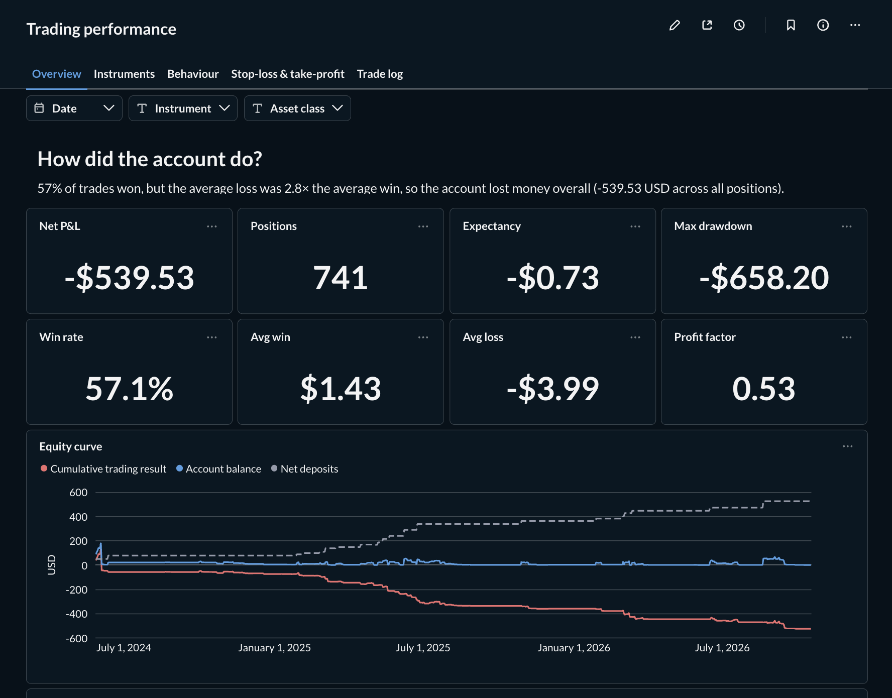

# Trading Analytics — dbt + DuckDB

A client-style case study in analytics engineering, built on a real CFD broker export.

**The brief:** a retail trader is losing money despite winning more trades than they lose, and wants to know
why — and what to change in their strategy.

**The approach:** raw broker exports → staged and tested dbt models → performance marts → a dashboard that
answers the question.

**The finding:** 57% of trades won, but the average loss was 2.8× the average win, so the account lost money
overall. The stop-loss & take-profit analysis shows where that asymmetry comes from.

> Status: staging, intermediate and mart layers built and tested (`dbt build`: 13 models, 1 seed, 93 tests), plus a Metabase dashboard built from code.



## Stack

| Layer | Tool |
|---|---|
| Warehouse | [DuckDB](https://duckdb.org) (local file, no server) |
| Transformation | [dbt-core](https://docs.getdbt.com) + [dbt-duckdb](https://github.com/duckdb/dbt-duckdb) |
| Packages | [dbt_utils](https://hub.getdbt.com/dbt-labs/dbt_utils/latest/) (date spine, generic tests) |
| Editor | VS Code + [dbt Power User](https://marketplace.visualstudio.com/items?itemName=innoverio.vscode-dbt-power-user) |
| Environment | conda (Python 3.12) |

## Data

Two CSV exports from the broker, placed in `data/`:

| Source | Grain | Rows (to 16.10.2026) |
|---|---|---|
| `leveraged_trades_history_all_*.csv` | one row per execution event on a position (open / close / modify / swap) | 2,687 |
| `funds_history_all_*.csv` | one row per cash movement, with running balance | 843 |

The raw files are **not committed** (they contain account identifiers). To run the
project, drop your own exports with the same file names into `data/`.

## Project structure

```
.
├── data/                  # raw CSV exports (git-ignored)
├── models/
│   ├── staging/           # 1:1 with sources: cast, rename, filter
│   ├── intermediate/      # business logic (e.g. one row per position)
│   └── marts/             # final facts, dimensions and performance tables
├── tests/                 # singular tests (e.g. reconciliations)
├── macros/  seeds/  analyses/  snapshots/
├── metabase/              # local Metabase (Docker) + script that builds the dashboard
├── warehouse/             # DuckDB database file (git-ignored)
├── dbt_project.yml
├── profiles.yml           # DuckDB connection — no secrets, so it lives in the repo
├── environment.yml        # conda environment
└── requirements.txt       # pinned Python packages
```

## Setup

```bash
# 1. Create and activate the environment
conda env create -f environment.yml
conda activate trading-analytics

# 2. Install dbt packages (dbt_utils) and check dbt can connect (run from the project root)
dbt deps
dbt debug

# 3. Build everything (models + tests)
dbt build
```

`profiles.yml` sits in the project root, and dbt picks it up automatically when
commands are run from here.

### VS Code + dbt Power User

1. Open the project folder in VS Code and install the recommended extensions when prompted.
2. `Cmd+Shift+P` → **Python: Select Interpreter** → choose `trading-analytics`.
3. Power User then gives you model lineage, compiled SQL preview and query results inside the editor.

## Useful commands

```bash
dbt build                      # run models + tests
dbt run -s staging             # run one layer
dbt test                       # tests only
dbt show -s <model>            # preview a model's output
dbt docs generate && dbt docs serve   # browse docs and lineage
```

## Dashboard (Metabase)

A local Metabase reads the marts read-only. The dashboard is built from code
(`metabase/build_dashboard.py`, Metabase REST API) rather than clicked together, so it
can be recreated on a fresh instance.

```bash
docker compose -f metabase/docker-compose.yml up -d --build      # http://localhost:3000
python metabase/build_dashboard.py --email you@example.com      # first run: creates admin + connection
python metabase/build_dashboard.py                               # later runs: rebuild the dashboard
docker compose -f metabase/docker-compose.yml restart            # after every dbt build
```

See the screenshot at the top of this README.

Tabs: **Overview** (KPIs, equity curve, drawdown, cash-flow waterfall, monthly P&L),
**Instruments** (P&L, win rate vs. payoff, scorecard), **Behaviour** (exit reason,
stop-loss use, holding time, P&L distribution, time of day, long/short), **Stop-loss & take-profit** and **Trade log**.
Filters: date, instrument, asset class.

The official Metabase image is Alpine-based and can't load DuckDB, so `metabase/Dockerfile`
builds Metabase with the [DuckDB driver](https://github.com/motherduckdb/metabase_duckdb_driver)
on a glibc base. DuckDB's file lock doesn't reach into the container, so Metabase won't
block `dbt build`, but it keeps serving the old data until restarted.

## Roadmap

- [x] Project setup (conda, dbt, DuckDB, sources)
- [x] Staging models for trades and funds
- [x] `int_positions`: one row per position (side, size, hold time, P&L, exit reason)
- [x] Marts: positions, daily P&L, daily balance, performance by instrument
- [x] Reconciliation tests (trade P&L = funds ledger; balance rebuilds exactly)
- [x] Metabase dashboard, built from code
- [x] Dashboard screenshot in this README

## Models

| Layer | Model | Grain |
|---|---|---|
| staging | `stg_trade_executions` | execution event |
| staging | `stg_fund_transactions` | ledger row (incl. declined) |
| intermediate | `int_positions` | position |
| intermediate | `int_position_modifications` | SL/TP change |
| intermediate | `int_ledger_transactions` | processed ledger row |
| marts | `dim_instruments`, `dim_dates` | instrument / day |
| marts | `fct_positions` | position |
| marts | `fct_ledger_transactions` | processed ledger row |
| marts | `fct_daily_pnl`, `fct_account_balance_daily` | day |
| marts | `mart_performance_by_instrument` | instrument |
| marts | `mart_performance_summary` | account (1 row) |

Seed `instrument_asset_classes` maps each symbol to an asset class. Singular tests in
`tests/` reconcile trade P&L, swaps and the running balance against the cash ledger.
